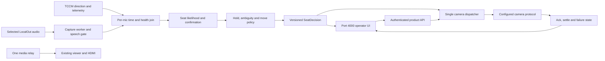

> Historical review: subsequent local opt-in speech integration and a staged Lumens PTZ fix are documented in `docs/SPEECH_GATE.md` and `docs/LIVE_SPEECH_PTZ_UPDATE.md`. Neither has been deployed to .84.

# Product review and implementation plan

Reviewed 16 November 2026. Scope: this ConfDeck checkout, the saved `.84` OmniTrack integration source, read-only HTTP checks of `192.168.1.84:4000`, and isolated software/browser tests.

## Decision

**Keep the existing product and finish its integration. Do not rewrite the tracking engine or ship speech-assisted locking as production-ready yet.** The spherical tracker, replay tooling, seat mapping and control safeguards provide a useful foundation. The new speech implementation is a promising diagnostic/offline prototype, not an active improvement to live seat locking.

The fastest credible release is one port-4000 product, one seat-decision service, one camera-command owner and an explicitly staged speech rollout. A lower threshold alone does not establish higher accuracy. It admits quieter speakers and more background sound. Speech probability answers whether speech is present; synchronized direction and calibrated seat geometry answer which seat should win.

This task changes presentation only. No tracking, capture, API, device settings, camera commands, remote files or services were changed. The implementation work below is a plan.

## What was actually verified

| Evidence | Result | Limit |
|---|---|---|
| Local regression suite | **275 passed**, 141.44 seconds | Software tests; not measured room accuracy |
| Existing UI smoke after visual edits | Passed: five routes, one WebSocket, isolated replay, joystick release, mocked device apply and mobile width | Temporary storage and mock devices |
| Saved `.84` tracking integration tests | **12 passed** | Tests the local integration snapshot, not physical camera movement |
| Saved configuration/auth tests | Could not run in this environment: Flask is absent | Earlier audit reports passes; those are historical, not new results |
| Output handoff JS check | Passed hold/reveal/blackout behavior | Simulated player states |
| Modified JavaScript syntax | Passed | Does not prove integration with every deployed backend |
| Focused checks after UI changes | **34 passed**: frontend boot, speech gate/capture, AES67 and Accuracy Lab | Subset of the full suite; not additional acoustic evidence |
| Extended visual review | Five desktop pages, tuning at 1024 px, home/tuning at 390 px, and dark home/tuning; no page errors, error toasts or page-width overflow | Isolated devices; screenshot harness uses the local read-only handoff response rather than a generic mock |
| Diagnostic CLI without `--enable` | OFF; opened no model or audio input | No live acoustic test performed |
| Live `.84` HTTP | Root and `/api/sennheiser/state` returned 200 | Read-only, no authenticated operator workflow or PTZ test |
| Live palette | `/css/premium.css?v=20261113` matched saved reference after line-ending normalization | Establishes the stylesheet reference, not full deployed-source parity |

Observed `.84` state: microphone Connected with fresh fields; engine `new` (spherical); `level_threshold=-47`, `level_gate=true`, `activity_gate=false`, evidence 250 ms, first-lock confidence .78, switch confidence .90, margin .20, minimum hold 1500 ms, settle 600 ms, move budget 20/min. At that instant the reported target was wide and the reason was below noise floor. No speech/audio-status fields were exposed. `tracking.live=false` is intentional in the merged system: OmniTrack owns camera commands, so it does **not** establish that OmniTrack's tracking switch is off.

The diagnostic notes describe earlier AES67 audio and real-model output on `.84`. That proves an audio/inference path was exercised, not that a labelled accuracy gain was demonstrated. Local source and the inspected integration path do not attach that evidence to live decisions. The saved integration source is dated 13 November; its backend findings need a deployed-file comparison before implementation.

Reproductions are saved in `artifacts/product-review/logic-probes.json`. Screens are in `artifacts/product-review/screens/`; UI originals and backend hashes are in `artifacts/product-review/before/` and `backend-before.json`.

## What is good, and what is ready

| Component | Good foundation | Readiness assessment |
|---|---|---|
| Direction / spherical seat inference | Angular geometry, clutter state, higher switching barrier, posterior margin, evidence duration, jump/frozen/parked rejection | Suitable for a controlled pilot after room calibration; unrestricted accuracy claim is unproven |
| Speech gate | Separate PCM dBFS domain; probability hysteresis; two-frame onset; 300 ms release; zero evidence during non-speech hangover; bounded history | Offline software is exercised; live product integration and acoustic acceptance remain |
| Audio capture | Explicit opt-in, local model, one inference thread, bounded buffering, scalar recording without PCM | Diagnostic-quality; stream identity, timing, stale handling and deployment lifecycle need work |
| Evaluation | Separate calibration/test tags, replay, time-weighted wrong-seat metrics, scalar coverage checks | Useful release tooling; acceptance metrics and ordering need corrections below |
| Seat/preset setup | Named scenes, per-seat mapping, confirmation/readback, original five-page flow | Retain; consolidate settings authority and confirm physical preset memories |
| Standalone camera control | Manual leases/deadman, cancellation generations, scene validation and downstream handoff state | Stronger foundation than the merged dispatcher; these protections do not automatically transfer to port 4000 |
| Merged ownership | Mic-only ConfDeck runtime blocks live camera control; adapter fails closed if a second owner appears | Correct architectural direction; retain the separation |
| Preview / display | Shared relay approach, retained output while destination loads, explicit blackout | Software behavior tested; HDMI, decoding and reboot acceptance still required |
| UI | Existing navigation and panel structure are usable; current pass improves palette, wording and radar text contrast | Visual changes ready for review; not a declaration that all backend functions are ready |
| Security / updates / release packaging | Some scoped transfer protections and backup handling exist | **Not ready for an unrestricted production release** |

## Findings to fix, in priority order

### P0 — Establish one reproducible release and one authorization boundary

1. **No committed source baseline.** `git log` reports no commits, the root files are untracked, and `integration/` is ignored. This makes the newest `.84` behavior difficult to reproduce and regressions hard to roll back. Create a reviewed, credential-free canonical source tree from an exact deployed-file manifest. Do not add the integration folder wholesale: it contains installation data and key material. Keep runtime settings and secrets outside source control.
2. **Port 4000 lacks consistent API authorization.** The saved backend has no central role check for legacy user, system, PTZ and microphone mutation routes; CORS and Socket.IO accept wildcard origins. The read-only Sennheiser state request succeeded without a session during this review. A custom request header is not authentication. Add Administrator/Operator/display roles, authenticated sockets and CSRF/origin checks to every relevant route. Do not simply expose the standalone API: `confdeck/app.py:identity` currently grants admin identity, with normal deployment relying on its loopback listener.

### P1 — Speech and threshold behavior do not yet form a live feature

3. **Speech is disconnected.** `Follow` constructs the normal engine; `SphericalFilter` and `QualityGate` default to `speech=False`. `speech_audio.py` owns a separate diagnostic worker. The evaluator is the place that joins scalar frames to mic events. Add the production join and lifecycle in shadow mode first; importing the model or adding a UI toggle alone is insufficient.
4. **The spherical gate ignores `level_gate`.** In `tracking_math/quality.py:feed`, low telemetry levels are rejected even when that checkbox is false. A probe with gate disabled, threshold −47 and input −60 still returns `below noise floor`. Decide and document one contract: level-only mode honors the configured policy; speech mode uses its own calibrated audio eligibility with direction-health checks. Expose only controls the selected engine honors.
5. **The adaptive telemetry floor cannot raise its effective threshold.** The code sets `floor=min(level_threshold-noise_margin, percentile)` and then gates with `max(level_threshold, floor+noise_margin)`. Algebraically this is always `level_threshold`. The displayed floor may move, but the rejection boundary remains fixed. Separate the calibrated absolute floor from a bounded adaptive estimate, and test rising HVAC noise without letting sustained speech train the floor upward.
6. **Low threshold plus audio loss can undo the intended protection.** Missing VAD currently requests the old level-only fallback. If that threshold was lowered for quiet voices, a capture failure can admit the very noises VAD was intended to reject. Use an explicit policy: invalid direction always inhibits a new lock; VAD loss uses a separately validated conservative level profile or holds the last shot and reports degraded operation. Never silently reuse the quiet-speech threshold as an outage fallback. Healthy silence must remain different from missing/invalid audio.
7. **Capture time and health need one validated contract.** `AudioCapture.snapshot` checks receipt age, not the frame's capture age; the probe returns a ten-second-old frame when its receipt is fresh. The local-device worker drops old frames, but the AES67 worker resets the model on stale input and still processes/publishes that frame. The CLI permits 0–250 ms latency while evidence expires after 96 ms. Validate capture age at the join, discard stale/backlogged frames, and define whether timestamps describe frame start/end. Reset and reacquire after loss; do not interpret inserted silence as valid acoustic evidence.
8. **AES67 reception is a limited diagnostic implementation.** `aes67.py` anchors time to first packet arrival minus configured latency; it does not discipline that clock with PTP, preserve/check SSRC identity, or implement a full reorder/playout jitter buffer. Late packets are discarded. Stereo is averaged, so mixed LocalOut/FarEndOut or opposite-phase channels are unsafe assumptions. Require a known local-speech channel, explicit stream/source binding, bounded reorder handling, discontinuity counters and long-run drift measurements. Keep channel selection separate from downmix policy.

### P1 — A seat decision is not a verified preset result

9. **Port 4000 loses decision identity at the adapter.** `driver_sennheiser.py` polls the whole state and turns `tracking.current` into microphone booleans. The listener polls again after roughly 150 ms plus HTTP/command time. This discards decision ID, evidence age, settings revision and reason, making replayed/retained state harder to distinguish from a new decision. Replace the control path with a versioned decision stream and deduplication; retain snapshots for rendering and recovery only.
10. **Automatic and manual dispatch differ.** The automatic listener invokes brand modules directly and records the last-active seat even after command exceptions. The manual `ptz_service.py:recall_preset` can issue brand, raw/framed VISCA and ONVIF commands for one request, clamps some preset IDs and reports success without proving arrival. Route both through one selected protocol per camera. Validate preset ranges, retain failures for bounded retry, and distinguish requested, sent, acknowledged, settled and failed. Do not claim settled from a timer unless marked estimated.
11. **Release operation still has material blockers.** The saved update route reports verified firmware before proving signature verification. The earlier `.84` audit reports root runtime and a pre-start command that kills shared media ports; the checked-in service-fix script contains that kill behavior. Recheck actual service units, establish one relay owner, use graceful restarts, least privilege and a verified update/rollback path. These are release gates, not changes made by this task.

### P2 — Evaluation and tuning need to reflect the operator's intent

12. **Timestamp ties affect replay.** `merge_scalar_frames` appends audio after existing rows and sorts only by time; `run` also sorts only by time. A mic event at t=0 before its audio frame has coverage 0; reversing the same-time pair gives coverage 1. Sort with a defined event priority (audio before direction at equal timestamps) after applying clock offsets. Validate chronological order again after alignment.
13. **The acceptance guard is both incomplete and sometimes impossible.** It requires strictly fewer noise triggers and strictly more quiet locks. A baseline already at zero and 100% cannot improve strictly. Conversely, it does not constrain normal-speech misses or p95 latency, and successful-trial median alone can hide misses. Keep the current conservative guard until a replacement is tested. Add absolute targets, non-regression on all speech conditions, sample counts, missed-trial rates and uncertainty; require improvement on the targeted low-level/noise cases when the baseline has headroom.
14. **Quiet-speech detection is not quiet-seat success.** Reliability scales as probability times audio margin/12. A voice just above the floor receives little seat evidence and may never cross the posterior barrier. Calibration currently counts a speech start rather than sustained correct seat locking; spatial model calibration also has a fixed telemetry cutoff of −65. Evaluate the complete seat pipeline before adjusting the weighting curve or calibration eligibility.
15. **Profiles modify several controls implicitly.** `mic-tuning.js:propose` rebuilds confirmation/hold from the selected starting profile on every slider change; initial profile selection is Balanced even for custom settings. Adjusting the threshold or orientation can therefore also change timing. Tolerance edits clear learned components. Introduce canonical, versioned profile recipes with explicit changed-field review and durable restore. Label `confirm_ms` as legacy confirmation and `evidence_floor_ms` as spherical evidence; they are not interchangeable speed controls.
16. **Do not infer multi-mic speech readiness from the existing multi-mic tests.** The speech evaluator rejects non-primary seats, the merged adapter selects primary seats, and `MultiMicFilter` constructs engines without speech enabled. First release can deliberately support one TCCM speech source; later add per-mic VAD state, independent clocks/floors and arbitration. One room-wide probability must not qualify every microphone's direction.

## Target architecture

Keep the current process boundary for the first release: **4000 owns the product, permissions, manual/automatic commands and `/viewer`; loopback 8765 owns microphone acquisition and seat decisions.** Keep ConfDeck's camera dispatch disabled in this mode. Reuse proven control primitives inside the single dispatcher without creating a second camera owner. The inference worker must never block on camera I/O or browser polling.

Minimum internal contracts:

- `SpeechEvidence`: mic/source ID, sequence, capture time, receive time, probability, PCM dBFS, noise-floor estimate, reliability, valid/healthy flag, discontinuity and model/config revision. Validate bounds and freshness server-side.
- `DirectionSample`: mic ID, acquisition/receive time, direction, telemetry level and its own age, beam-freeze/activity validity. Do not treat direction arrival as proof that the separate level field is fresh.
- `SeatDecision`: unique decision ID plus service epoch, mic ID, seat ID, posterior/margin, evidence interval, reason, settings revision and eligibility. Keep inferred speaker state separate from last displayed shot.
- `PresetIntent`: decision ID, camera ID, preset token, generation/expiry and manual/automatic origin. Deduplicate by decision/camera. A stop invalidates queued generations; a new target supersedes stale queued work.
- `CameraResult`: intent ID, sent/acknowledged/settled timestamps, protocol, verified/estimated flag and failure reason. Do not mark a failed attempt as completed.

## How threshold, speech, seat lock and preset trigger should cooperate

1. **Capture and device setup:** verify the intended local-speech audio channel actually reaches the model. Device sensitivity/noise gate and app telemetry threshold are different controls. If an upstream gate removes quiet speech, a downstream VAD cannot reconstruct it. Read back device changes and measure their effect before lowering anything else. Sennheiser documents sensitivity, noise-gate and far-end controls separately in its [Control Cockpit manual](https://docs.cloud.sennheiser.com/en-us/control-cockpit/control-cockpit_user_manual_v9.1.2_en.pdf).
2. **Speech eligibility:** apply probability hysteresis and an audio-domain noise margin to fresh frames. Retain current two-frame onset and release behavior as a starting point, not a certified optimum. The local 512-sample/16 kHz recurrent adapter is consistent with the [Silero wrapper interface](https://github.com/snakers4/silero-vad/blob/master/src/silero_vad/utils_vad.py); model outputs still need room-specific validation.
3. **Direction eligibility:** reject stale/invalid/frozen/far-end input independently. High speech probability must not override these checks. VAD can also detect reproduced speech from a loudspeaker; far-end reference/beam-freeze and spatial exclusion remain necessary. Treat simultaneous speakers as ambiguity, not an automatic nearest-seat win.
4. **Seat inference:** fuse qualified evidence with spherical seat likelihoods. Require a first-lock confidence, a higher switch confidence, a runner-up margin and sustained evidence. A lower microphone threshold must not lower all four barriers. Keep the bounded 400 ms directional pre-roll only when corroborated by current eligible direction.
5. **Shot policy:** separate silence release, minimum shot hold, camera settle and rate budget. Speech ending does not mean immediately jump to another seat. Hold the last shot or use an explicitly configured wide decision; never convert an audio outage into a new speaker.
6. **Preset execution:** emit once for a committed eligible decision. Queue by camera, supersede older work, honor manual control and Stop, and update displayed output only under the chosen acknowledgement/settle policy.

Begin shadow testing with the current spherical barriers (.78 first, .90 switch, .20 margin, 250 ms evidence) and existing VAD defaults (.50/.35, 5 dB PCM noise margin). These are comparison starting points, **not recommended universal room settings**. Test low-voice mode independently. Do not reduce camera hold merely to compensate for a weak speech score.

Measure latency in separate stages: acoustic onset → usable audio/direction → seat decision → queued/sent command → acknowledged/settled camera → visible frame. Audio and direction run in parallel. Do not add every configured timer together or report the 32 ms frame length as total switching latency. The current merged poll adds approximately 0–150 ms before HTTP and command work under healthy conditions; actual end-to-end latency is unmeasured.

## Port-4000 alignment plan

Changing `--port` to 4000 is insufficient: OmniTrack already binds it, uses different routes and Socket.IO, and the mic-only runtime has a restrictive allowlist. The standalone frontend expects `/api/state`, `/api/ws`, scene/manual/display APIs and static assets. Those contracts are not all available through `/api/sennheiser/*`.

| Surface | Implementation contract |
|---|---|
| Product entry | Keep port 4000 and the existing `/viewer`; preserve the current root/operator routing during migration |
| UI integration | Mount shared seat/tuning modules through a small transport adapter; retain each product's original page structure |
| HTTP | Use relative same-origin URLs behind the authenticated product API; explicitly map allowed methods/endpoints instead of opening an unrestricted proxy |
| Live state | Add a versioned Sennheiser state/decision feed; bridge it into the existing product transport. Native WebSocket and Socket.IO are not interchangeable |
| Capabilities | Return supported engine, speech mode, camera owner, preview/calibration capability, schema version and build ID; render only supported controls |
| Settings | One authoritative mic/tracking store; OmniTrack owns camera configuration and derived seat-to-camera mapping. Use revisions and atomic apply/readback; reject stale edits |
| Identity | Persist camera/seat IDs; validate a one-time mapping from existing IDs/IPs without renumbering saved preset memories |
| Media | One relay process and URL contract. Keep viewer/kiosk clients read-only and preserve stream ownership across restarts |
| Packaging | Package only allowlisted source/assets, migration and manifest hashes; keep device settings, credentials, models and licenses deliberately managed |

The current UI changes need no fixed host/port: existing relative HTTP paths and `location.host` WebSocket URLs were retained. They improve visual alignment but do **not** implement these API mappings.

## Implementation sequence for the quickest credible release

| Stage | Work | Exit condition |
|---|---|---|
| 0 — Freeze and inventory | Compare `.84` deployed files with this checkout; select canonical source; capture source/config backups separately; record schema/build/model hashes and supported devices | Reproducible release, known file differences and tested restore on an isolated copy |
| 1 — Product boundary | Central auth/roles/socket authorization; one camera dispatcher; versioned state/decision API; relative route adapter; eliminate duplicate relay ownership | Stop/OFF prevents new automatic commands; unauthorized operations rejected; existing viewer and physical-mic behavior pass |
| 2 — Tracking correctness | Fix gate contract and adaptive-floor math; explicit fallback; canonical profiles; timestamp tie ordering; sample-age/stream-health validation | Deterministic tests for enabled/disabled gates, threshold changes, ties, stale/future frames, restart epochs and loss/recovery |
| 3 — Speech shadow mode | Add opt-in capture lifecycle and join; publish real health/status; run level-only and speech candidates on the same stream without issuing speech-driven commands | Representative labelled recordings with coverage/drop/clock reports and no camera-control regression |
| 4 — Controlled speech enablement | Calibrate on separate material; run held-out A/B; review setting deltas; persist restore point; enable on one room and supported camera set | Acceptance targets below met; no unreviewed threshold auto-apply; fallback verified by disconnect tests |
| 5 — Release packaging | Pin optional inference dependencies/model/license; verified installer/update; service recovery and HDMI tests; operator guide | Cold boot, power cycle, rollback and failure recovery pass on `.84` |

To wrap quickly, defer visual mouth tracking, automatic noise suppression, generic support for every camera, and multi-mic speech fusion. Ship a well-defined single-TCCM/supported-camera scope first. Existing physical conference-mic behavior must remain covered by regression tests.

## Proposed acceptance targets — not achieved measurements

- Label every seat across normal and quiet speech, varied speakers, adjacent/opposite turns, short utterances, keyboard/taps/chair noise, HVAC, far-end playback, overlap and prolonged silence. Randomize order. Keep calibration and held-out sessions separate.
- First candidate target: at least 95% quiet and 98% normal trial lock success, at least 95% correct-seat time, at most 1% wrong-seat time, and no missed-trial increase versus the validated baseline. Report every seat separately and expose misses rather than hiding them in latency.
- Target zero false camera triggers in at least 60 minutes of representative non-speech/echo testing, and publish the duration/count. Zero observed events is not proof of zero future false-trigger probability.
- Seat-decision median no more than 100 ms slower than baseline; report p95 and set a room-specific bound (start evaluation at 1.2 s). Measure camera/visible-frame latency separately by model and travel distance.
- Validate audio coverage, packet loss, clock drift and CPU/memory over an extended run. Exercise mid-sentence stream loss, stale/queued data, wrong source, model failure, network loss, manual override, Stop, restart and duplicate delivery.
- Require no duplicate automatic recall per decision/camera, no commands after Stop except an already transmitted command completing, and honest sent/acknowledged/settled status. Verify physical framing, not just HTTP 200 or video connectivity.
- Before a broad release, pass role/CSRF/origin tests, protected viewer behavior, import remaining disconnected across reboot, signed-update failure/rollback and real HDMI unplug/replug/power-cycle tests.

The existing seed-7 fixture was rerun: both no-audio comparison arms give **4.375% wrong-seat time, 0 false triggers/10 min, 100% quiet-trial lock rate and 650 ms median seat latency**. Coverage is zero and the guard rejects acceptance. These are synthetic direction/level results, not evidence that speech detection improved room performance.

## UI changes delivered in this pass

- White/slate surfaces, blue navigation and tuning controls, orange apply/save actions aligned with the live port-4000 palette; original five pages and panel arrangement retained.
- Clearer operator copy for overview, camera setup, seats, tuning, startup and connection state.
- Explicit speech-validation availability note; no fake enabled indicator or unsupported toggle.
- Labels distinguish telemetry threshold, seat confidence, minimum evidence and device gate hold; the level meter no longer calls a simple threshold comparison a confirmed open speech gate.
- Legible seat names on the light radar; maintained dark theme, focus styling and reduced-motion support.

These changes are local source changes, not a deployment to `.84`. The existing smoke check's expected heading color was updated for the new palette. No backend implementation from this plan was applied.
